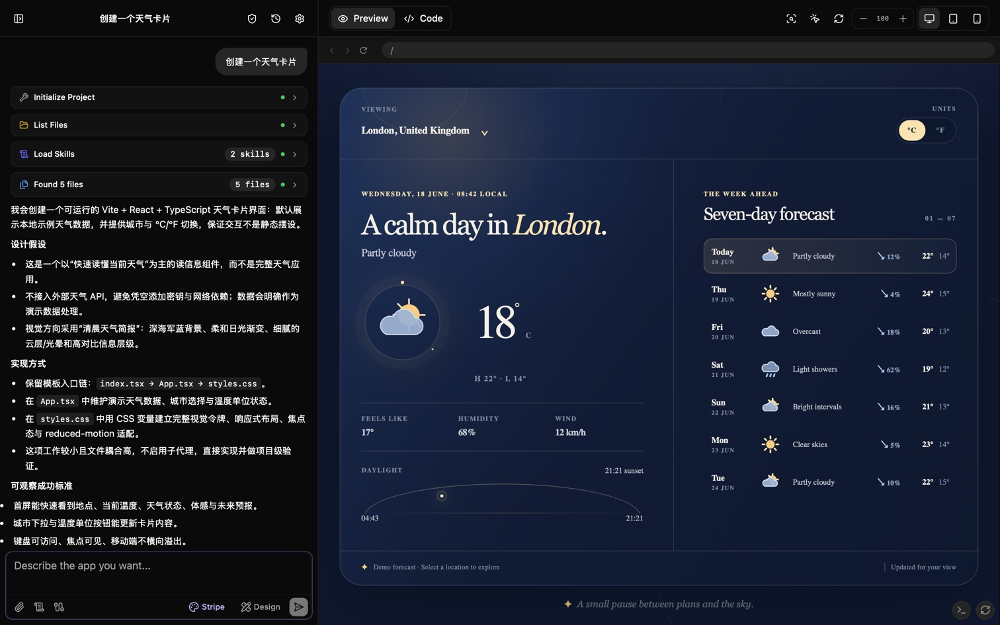

<div align="center">

# Open Builder

**AI-Powered Web App Generator — Describe in natural language, instantly generate runnable projects**

[](LICENSE)
[](https://react.dev)
[](https://www.typescriptlang.org)
[](https://vitejs.dev)
[](https://tailwindcss.com)
[](https://tauri.app)

[Deployment](#deployment) · [Quick Start](#quick-start) · [Features](#features) · [Architecture](#architecture) · [Changelog](CHANGELOG.md) · [Project Audit (Chinese)](docs/PROJECT_AUDIT.zh-CN.md) · [Contributing](CONTRIBUTING.md)

English | [简体中文](README.zh-CN.md)

</div>

---

## Introduction

Open Builder is a desktop-first AI web app generator with a browser-compatible interface. Simply describe the application you want to build in natural language, and the AI will create, modify, and delete files in an in-memory file system through a Tool Call loop, with live preview powered by [Sandpack](https://sandpack.codesandbox.io/).

Open Builder does not require a hosted application backend. The Web app connects directly to the providers and approved remote tools you configure; provider settings, including API keys, are stored in browser local storage and are sent only when required by those configured services.

The Tauri desktop build (macOS / Windows / Linux) provides local runtime capabilities such as stdio MCP. Web and experimental mobile builds intentionally omit local process and Skill script execution.

> Native adapters are included for OpenAI Responses, Anthropic, and Google, plus OpenAI-compatible endpoints such as Ollama and other compatible gateways.

---

## Demo



[Live Demo](https://builder.u14.app)

---

## Features

### Core

- **Natural Language to Code** — Describe your idea, AI plans and generates the complete project structure
- **Live Preview** — Browser-based sandbox powered by Sandpack, instant rendering on code changes
- **Multi-Framework Support** — 20+ templates including React, Vue, Svelte, Angular, SolidJS, and Astro, with Open Builder-managed dependency profiles and verified Sandpack/Nodebox runtime locks
- **Smart File Operations** — AI uses `patch_file` for precise modifications, avoiding unnecessary full rewrites
- **Dependency Management** — AI can modify `package.json` and trigger dependency reinstallation
- **Build Accelerators** — Install shadcn components, translate screenshots into components, apply design specifications, and manage typed environment schemas through dedicated tools
- **Project Guidance** — Root-level `AGENTS.md`, `CLAUDE.md`, and `DESIGN.md` files can guide generation while remaining untrusted project data that cannot override tool or safety policy
- **Project Snapshots** — Browse snapshot history, name snapshots, inspect diffs, export patches, and roll back to historical versions
- **Project Health Check** — Run `/health` to inspect structure, dependencies, runtime logs, accessibility, and responsive risks; isolated Automatic QA performs a restricted project check without MCP or preview-console access
- **Context Compression** — Use `/compact` or the command palette to summarize long conversations and reduce token usage
- **Plan Mode** — Explore the code and submit an implementation plan for approval before writing files; `ask_user_question` supports both independent clarification batches and one-question-at-a-time stress-test interviews
- **Design Mode** — Generate runnable marketing sites and multi-screen product interfaces with per-project Code / Plan / Design modes, curated or custom design systems, responsive interactions, and explicit design self-checks
- **Subagent Collaboration** — Built-in read-only subagents for code exploration, review, dependency advice, bug investigation, and UI critique
- **Built-in Search** — Supports enabling the model's built-in search service
- **Desktop API Proxy** — Tauri can forward approved HTTP/HTTPS provider requests that would otherwise be blocked by browser CORS; static Web deployments still depend on provider CORS support
- **Desktop Local CLI Runtime** — Explicitly run the complete generation workflow through a signed-in Codex CLI while keeping API mode as the default; the Claude adapter remains fail-closed until its CLI exposes compatible pre-input isolation

### User Experience

- **Multi-Session Management** — Sidebar with create, switch, delete sessions; history persisted locally
- **Session Organization** — Search, pin, archive, fork, and smart-rename conversations
- **Project Templates** — Save generated projects as reusable local templates and start new sessions from them
- **Smart Session Naming** — Auto-generates session titles based on conversation content
- **Slash Commands** — Input box supports `/new`, `/fork`, `/clear`, `/reset`, `/compact`, `/health`, `/review`, `/continue`, and `/retry`
- **Command Palette & Shortcuts** — Open commands with `Cmd/Ctrl+K`, create sessions, open settings, focus input, or stop generation from the keyboard
- **Image & File Input** — Upload screenshots, text files, or PDFs; PDF-capable models receive PDFs as native file input without local text extraction
- **Skills System** — Enabled Skills expose metadata for automatic discovery; full instructions load only after `read_skill` or when a Skill is selected for the next message, which also applies to subagents and clears after sending. Skill loads in one Agent turn appear as one expandable list. The eight built-ins are `debug-web-app`, `build-tailwind-ui`, `build-accessible-ui`, `write-safe-typescript`, `art-direct-web`, `design-product-ui`, `review-code`, and `simplify-code`; legacy built-in IDs migrate automatically, while imported Skills start with discovery disabled
- **Custom Instructions** — Advanced settings can safely append up to 32,000 characters to Chat, Plan, retry, and subagent requests without granting tools or changing mode restrictions; utility calls such as Automatic QA, titles, and compression exclude them
- **Local Settings** — Provider configuration, API keys, and custom instructions persist in browser local storage
- **Storage Governance** — Inspect local data usage and safely clean archived sessions, empty sessions, and old snapshots
- **Streaming Output** — Real-time display of AI thinking process and code generation progress
- **Extended Thinking** — Supports Extended Thinking / Reasoning mode (DeepSeek-R1, Claude 4.6, etc.)
- **One-Click Download** — Export generated project as a ZIP file
- **Workspace Tools** — Switch between code and preview, search and manage files, inspect the Sandpack console, and preview desktop/tablet/phone widths with fit and zoom controls
- **Interactive Design Editing** — Point-select stable `data-ob-id` elements in supported Sandpack previews, pass a sanitized selection to the next request, and tune canonical semantic tokens with snapshot-backed saves
- **Design Review & Desktop Export** — Upload up to three screenshots for an opt-in read-only review on Web or desktop, or export canonical project files from desktop to a new non-overwriting directory
- **Adaptive Layout** — Desktop uses a horizontal resizable split, tablets use a vertical resizable workspace-over-chat split, and phones use a chat-first layout with inline preview
- **Languages & Themes** — English and Simplified Chinese interfaces with system, light, and dark themes

### Commands and Shortcuts

| Command     | Behavior                                                  |
| ----------- | --------------------------------------------------------- |
| `/new`      | Start a new session                                       |
| `/fork`     | Fork the current session and project                      |
| `/clear`    | Clear chat context while keeping current project files    |
| `/reset`    | Reset the current conversation and project after approval |
| `/compact`  | Compress the current conversation context                 |
| `/health`   | Run the project health check                              |
| `/review`   | Ask the AI to review the current project                  |
| `/continue` | Continue an interrupted or incomplete task                |
| `/retry`    | Retry the latest generation                               |

| Shortcut     | Action                                             |
| ------------ | -------------------------------------------------- |
| `Cmd/Ctrl+K` | Toggle the command palette                         |
| `Cmd/Ctrl+N` | Start a new session                                |
| `Cmd/Ctrl+,` | Open settings                                      |
| `Cmd/Ctrl+/` | Focus the chat input                               |
| `Esc`        | Close the palette first, otherwise stop generation |

### Design Mode

Design mode keeps its output in the current conversation's normal project file tree and Sandpack preview; it does not create a separate artifact store. The Code label retains the existing internal `"auto"` value for compatibility. The mode and its automatic decision, selected system, and applied system are remembered per project. Entering Plan from Design returns to Design after approval.

- New visual projects default to `vite-react-ts`; explicitly requested lightweight static pages can use `static`.
- The built-in catalog contains 12 curated, unofficial visual references with separate full-frame 640×480 WebP previews: Linear, Stripe, Claude, GitHub, IBM, Figma, Notion, Shopify, Apple, Spotify, The Verge, and WeChat. Choosing a different system for an initialized project immediately starts its AI application workflow; an empty project keeps the choice as the reference for its next Design request.
- When the selector remains **Auto**, one isolated no-tool model decision runs before the next Design generation. It can choose a bundled, imported, or custom system, or explicitly choose **None**. A validated result remains with that project until it is manually replaced or re-evaluated; an invalid result is retried on the next request.
- Custom systems require a name plus three visible rule groups. The current API or Local CLI model compiles them without project files or tools; strict JSON, CSS, semantic-token, and complete-package validation must pass before the system is saved and selected. Custom and imported systems share the generic full-frame WebP preview.
- Imported systems use the minimal `manifest.json + DESIGN.md + tokens.css` contract. ZIP and directory imports are previewed before confirmation, validated as bounded text-only packages, and never silently overwrite an existing ID.
- Point selection is available for `static`, `vite`, `vite-react`, and `vite-react-ts`. Unsupported or code-only projects can still use Design prompts and file tools, but the UI explains why selection or live token preview is unavailable.
- Legacy root-only `DESIGN.md` files remain read-only visual references until the user explicitly upgrades them to a token-bearing system.

| Capability                              | Web                                              | Desktop                                                              |
| --------------------------------------- | ------------------------------------------------ | -------------------------------------------------------------------- |
| Generation, live preview, point editing | Full core flow                                   | Full core flow                                                       |
| Design-system import                    | ZIP or browser directory picker                  | ZIP or local directory                                               |
| Project export                          | ZIP                                              | ZIP or a new, uniquely named directory; no two-way sync              |
| Model runtime                           | API or remote endpoint that permits browser CORS | API, Tauri proxy, or supported local CLI runtime                     |
| Visual review                           | User-uploaded screenshots                        | User-uploaded screenshots                                            |
| Local processes / stdio / Skill scripts | Unavailable in a static Web deployment           | Subject to the existing desktop capability and approval restrictions |

Design Review is deliberately separate from Automatic QA. Its restricted run can only list, read, and search project files and submit up to eight structured findings; it cannot write files, use MCP or network tools, load Skills, or run scripts. No fix runs until the user selects findings and clicks **Apply selected fixes**.

### MCP and Platform Capabilities (Optional)

- Configure remote HTTPS MCP servers with Streamable HTTP or SSE, static headers, OAuth authorization code, or OAuth client credentials; desktop builds also support stdio servers.
- Import server definitions from JSON, enable servers and tools independently, and review tool-definition drift before changed capabilities can run.
- Plan Mode and subagents receive only MCP tools explicitly approved as read-only for those modes.

| Runtime             | Remote HTTPS MCP | stdio MCP | Skill scripts                        |
| ------------------- | ---------------- | --------- | ------------------------------------ |
| Web                 | Yes              | No        | No                                   |
| Desktop             | Yes              | Yes       | Developer switch + per-call approval |
| Experimental mobile | Yes              | No        | No                                   |

### Web Search

- [Firecrawl](https://www.firecrawl.dev) is the default for new or reset settings and supports keyless search and page reading under IP-based limits; an optional API key raises those limits
- [Tavily](https://tavily.com) and [Exa](https://exa.ai) are available with provider credentials; supported model providers can also use built-in search
- Web content reading automatically falls back to [Jina Reader](https://jina.ai/reader/) when a configured reader cannot return a page

---

## Quick Start

### Prerequisites

- Node.js 24 LTS
- pnpm 11
- A supported provider endpoint and an API key when that provider requires one

### Installation

```bash
# Clone the repository
git clone https://github.com/Amery2010/open-builder.git
cd open-builder

# Install dependencies
pnpm install

# Start the development server
pnpm dev
```

Open `http://localhost:5173` in your browser, click the settings icon in the top-right corner to configure your API Key.

### Desktop / Mobile App (Tauri)

Requires [Rust](https://www.rust-lang.org/tools/install) and Tauri [platform dependencies](https://tauri.app/start/prerequisites/).

```bash
# Desktop development
pnpm tauri:dev

# Desktop build
pnpm tauri:build

# iOS development / build
pnpm tauri ios init # first setup only
pnpm tauri:ios:dev
pnpm tauri:ios:build

# Android development / build
pnpm tauri android init # first setup only
pnpm tauri:android:dev
pnpm tauri:android:build
```

### Local CLI Runtime (Desktop)

The desktop app can use an installed Codex CLI as a complete agent runtime. API mode remains the default and Open Builder never silently falls back between runtimes. The Claude adapter is included, but current Claude CLI releases are reported as **Unsupported** because they cannot prove isolation before receiving user content while also retaining both the Open Builder MCP bridge and subscription authentication.

1. Install the official Codex CLI and sign in with `codex login`.
2. Start the desktop app and open **Settings → Model → Runtime → Local CLI**.
3. Select Codex. Open Builder scans `PATH` and common installation locations; **Choose program** can store a validated executable override in native app data. Claude remains visible for capability diagnostics but cannot start a turn until a compatible CLI protocol is available.
4. Confirm that the status is **Installed and signed in**, then optionally select a model and reasoning effort reported by the CLI.

The local CLI is not an offline model. Prompts, attachments, web-search activity, and tool results are normally sent to the selected provider and may consume account subscription or usage quota. Open Builder checks login status but does not read, copy, or persist CLI credentials.

Projects remain in Open Builder's in-memory virtual file system. The CLI runs in an isolated empty directory and can interact with the project only through the per-run loopback MCP bridge. Attachment IDs are opaque; host file paths are not exposed. Provider configuration, hooks, unrelated MCP servers, shell tools, and CLI project-instruction injection are rejected or disabled before user content is sent.

When Web Search is **Model Built-in**, local mode uses the selected CLI's native search. Tavily, Firecrawl, or Exa selections instead use the existing Open Builder tools and keep native search disabled. If detection reports not installed, signed out, unsupported, or an isolation error, use **Rescan**, **Choose program**, **Use auto-detection**, or copy the displayed login command. Web and mobile builds show a blocking message and require switching back to API.

### Configuration

Click the settings button in the top-right corner and fill in:

| Option              | Description                                   | Example                               |
| ------------------- | --------------------------------------------- | ------------------------------------- |
| API Type            | Provider protocol adapter                     | OpenAI, Anthropic, Google, compatible |
| API Key             | Provider credential, when required            | `sk-...`                              |
| API Base URL        | Provider origin or base path                  | `https://api.openai.com`              |
| Model Name          | Model ID; supported providers can list models | `gpt-5.6-sol`, `deepseek-chat`        |
| Web Search          | Keyless Firecrawl, or provider credentials    | `fc-...`, `tvly-...`, or an Exa key   |
| Image Search        | Optional Pixabay or Unsplash credential       | Provider API key                      |
| Custom Instructions | Reusable instructions under Advanced settings | Up to 32,000 characters               |

> Settings and API keys are stored in browser local storage. Custom instructions are sent to the selected model provider for Chat, Plan, retry, and subagent work. They cannot expand tool permissions; do not place credentials or other secrets in them. Treat the browser profile and device as part of your credential security boundary.

MCP servers and Skills are managed from the chat toolbar. A Skills management switch controls metadata auto-discovery only. Selecting a Skill in the toolbar loads its full instructions for the next request and then clears the selection. Desktop-only options are shown only when the native runtime reports the required capability.

---

## Architecture

### Core Engine: WebAppGenerator

[src/lib/ai/generator.ts](src/lib/ai/generator.ts) is the project's core, implementing the full AI Tool Call loop engine:

```
                         ┌─ API Backend → AI SDK
User Message → Generator┤
                         └─ Local CLI Backend → Tauri Agent Manager
                                                  ↓
                                      Loopback MCP Tool Bridge
                                                  ↓
                                   Shared Tool Executor and Policy
                                                  ↓
                                      In-Memory File System
                                                  ↓
                                       Sandpack Live Preview
```

Built-in tools:

| Tool                             | Description                                                                                             |
| -------------------------------- | ------------------------------------------------------------------------------------------------------- |
| `init_project`                   | Initialize Sandpack project template                                                                    |
| `manage_dependencies`            | Modify package.json to manage dependencies                                                              |
| `list_files`                     | List all project files                                                                                  |
| `read_files`                     | Batch read file contents                                                                                |
| `write_file`                     | Create or overwrite a file                                                                              |
| `patch_file`                     | Precise search-and-replace patch                                                                        |
| `delete_file`                    | Delete a file                                                                                           |
| `rename_file` / `move_file`      | Rename or move files while updating relative imports                                                    |
| `search_in_files`                | Global file content search                                                                              |
| `get_console_logs`               | Read Sandpack preview console output                                                                    |
| `compact_context`                | Compress long conversation context                                                                      |
| `ask_user_question`              | Ask 1-4 independent clarifications, or run a dependent stress-test interview one question at a time     |
| `exit_plan_mode`                 | Submit a plan and wait for user approval                                                                |
| `dispatch_subagent`              | Dispatch read-only subagents for exploration, review, or diagnosis                                      |
| `project_health_check`           | Inspect project structure, package files, env schema, console logs, accessibility, and responsive risks |
| `web_search`                     | Web search (supports Built-in, Tavily, Firecrawl, Exa)                                                  |
| `web_reader`                     | Read web page content                                                                                   |
| `image_search`                   | Image search (supports Pixabay, Unsplash)                                                               |
| `search_npm_packages`            | NPM package search                                                                                      |
| `get_npm_package_detail`         | Get detailed information about NPM package                                                              |
| `install_component`              | Install an approved shadcn registry component and its dependencies                                      |
| `screenshot_to_code`             | Generate and write a component from a supplied UI image                                                 |
| `apply_design_style`             | Add a selected design specification to the project                                                      |
| `apply_design_system`            | Apply the explicitly selected Design-mode system contract to an initialized project                     |
| `submit_design_review`           | Submit the bounded structured result from the read-only Design Review profile                           |
| `list_skills` / `read_skill`     | Discover enabled Skill metadata, then load full instructions and resource listings                      |
| `execute_skill_script`           | Run an active skill script in the desktop app only                                                      |
| `read_env_schema` / `manage_env` | Safely inspect and manage env files                                                                     |

Enabled MCP tools are injected dynamically after server discovery and approval, then filtered by the current platform and Chat, Plan, Design, Automatic QA, Design Review, or subagent run policy. `apply_design_style` remains the Auto-mode compatibility path; Design mode uses `apply_design_system`.

### Tech Stack

| Category       | Technology                        |
| -------------- | --------------------------------- |
| Framework      | React 19 + TypeScript 6           |
| Build Tool     | Vite 8                            |
| Styling        | Tailwind CSS v4                   |
| UI Components  | shadcn/ui + Radix UI              |
| Code Sandbox   | Sandpack (CodeSandbox)            |
| State Mgmt     | Zustand 5                         |
| Local Storage  | localforage                       |
| Icons          | Lucide React                      |
| Markdown       | react-markdown + rehype-highlight |
| Desktop/Mobile | Tauri 2                           |

---

## Supported API Protocols

Open Builder selects a native AI SDK adapter from the configured API Type and can query supported provider endpoints for their model list.

| API Type          | Protocol/adapter           | Default base URL                            | Typical use                    |
| ----------------- | -------------------------- | ------------------------------------------- | ------------------------------ |
| OpenAI Compatible | OpenAI-compatible chat API | `http://localhost:11434`                    | Ollama and compatible gateways |
| OpenAI            | Responses API              | `https://api.openai.com`                    | OpenAI                         |
| Anthropic         | Messages API               | `https://api.anthropic.com`                 | Anthropic                      |
| Google            | Generative Language API    | `https://generativelanguage.googleapis.com` | Google Gemini                  |

> For best results, use a model with strong Function Calling support.

---

## Deployment

Static Web deployments do not include the Tauri API proxy, stdio MCP, or Skill script execution. Model and search endpoints used directly from a browser must allow the deployment origin through CORS.

### Build for Production

```bash
pnpm build
# Output to dist/ directory
```

### Docker / GitHub Container Registry

The lightweight container image serves the Web build with an unprivileged Nginx Alpine runtime:

```bash
docker run --rm -p 8080:8080 ghcr.io/amery2010/open-builder:latest
```

Open `http://localhost:8080`. The image supports `linux/amd64` and `linux/arm64`. It intentionally contains no provider credentials, API proxy, stdio MCP, Local CLI, or Skill script runtime; browser-facing provider and search endpoints must allow the deployed origin through CORS.

Pushing a semantic version tag such as `v1.8.0` runs the frontend quality gates and a container smoke test before publishing `1.8.0`, `1.8`, `1`, and `latest` tags to `ghcr.io/amery2010/open-builder`. Pre-release tags publish only their full pre-release version. GitHub initializes a new container package as private, so a repository owner must change its visibility to public once after the first successful publish.

See [.github/workflows/release.yml](.github/workflows/release.yml).

### GitHub Pages

GitHub Actions builds and deploys Pages when `main` is updated (or when the workflow is started manually). The workflow sets Vite's base path to the repository subpath, including the static MCP OAuth callback entry. A `v*` tag creates a draft desktop release and publishes the container image after their respective quality gates pass; it does not deploy Pages.

See [.github/workflows/deploy.yml](.github/workflows/deploy.yml).

### Vercel

[](https://vercel.com/new/clone?repository-url=https%3A%2F%2Fgithub.com%2FAmery2010%2Fopen-builder)

Or manually: import the GitHub repo, select `Vite` as framework preset, build command `pnpm run build`, output directory `dist`.

### Cloudflare Workers

[](https://deploy.workers.cloudflare.com/?url=https://github.com/Amery2010/open-builder)

Or manually:

1. Log in to [Cloudflare Dashboard](https://dash.cloudflare.com/) → Workers & Pages → Create → Worker → Connect to Git
2. Select the `open-builder` repo with the following build config:

| Option        | Value            |
| ------------- | ---------------- |
| Build Command | `pnpm run build` |
| Output Dir    | `dist`           |
| Node.js Ver   | `24`             |

### Netlify

Import the repo, build command `pnpm run build`, output directory `dist`. No additional configuration needed.

---

## Contributing

Issues and Pull Requests are welcome! Please read the [Contributing Guide](CONTRIBUTING.md) first.

---

## License

[GPLv3 License](LICENSE) © 2026 Open Builder Contributors
