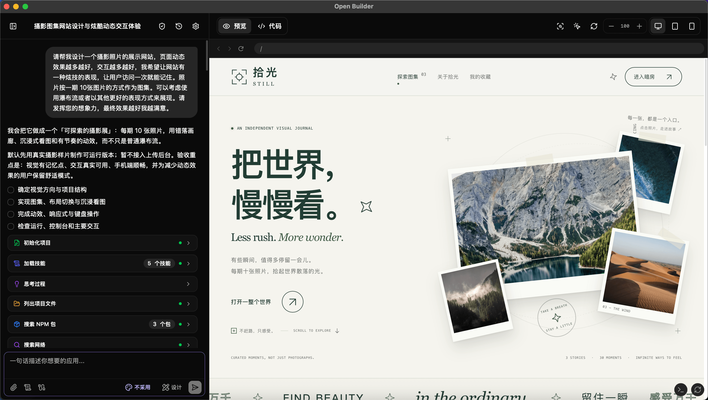

<div align="center">

# Open Builder

**用对话构建 Web 应用。**

[](LICENSE)
[](https://react.dev)
[](https://tauri.app)

[在线体验](https://builder.u14.app) · [下载](https://github.com/Amery2010/open-builder/releases) · [文档](#文档) · [更新日志](CHANGELOG.md)

[English](README.md) | 简体中文

</div>

Open Builder 是开源的 AI Web 应用开发工作区。连接自己的模型服务，在浏览器或桌面应用中生成、编辑和预览项目，完成后导出源码。



## 核心功能

- **编程、计划与设计** — 直接开发、先批准方案，或创建多页面产品原型。
- **实时预览** — 提供 20 多种框架模板、代码编辑器、控制台及响应式设备预览。
- **可视化修改** — 在设计画布上排列页面，选择 36 套设计系统，在 19 种预览模板中点选元素，或批注截图。
- **项目历史** — 保存快照与分支，复用项目模板，下载源码或受支持的静态部署 ZIP。
- **模型自由选择** — 支持 OpenAI、Anthropic、Google 及兼容 API；桌面端还支持 Codex、Claude、Pi 和 Antigravity CLI。
- **工具与协作** — 连接 MCP 服务、加载 Skills、搜索网页，并向子代理分配明确范围的任务。

## 快速开始

直接使用 [Web 应用](https://builder.u14.app)，或使用 Node.js 24 和 pnpm 11 在本地运行：

```bash
git clone https://github.com/Amery2010/open-builder.git
cd open-builder
pnpm install
pnpm dev
```

打开 [localhost:5173](http://localhost:5173)，在**设置**中配置 API 类型、地址、模型与凭据，然后描述你想构建的应用。

开发桌面版需要安装 [Rust](https://www.rust-lang.org/tools/install) 和 [Tauri 平台依赖](https://tauri.app/start/prerequisites/)，随后运行：

```bash
pnpm tauri:dev
```

模型配置、本地 CLI 接入与项目工作流详见[使用指南](docs/user-guide.zh-CN.md)。

## 平台支持

| 能力                            | Web    | 桌面端       | 移动端（实验性） |
| ------------------------------- | ------ | ------------ | ---------------- |
| API 模型、项目编辑与预览        | 支持   | 支持         | 支持             |
| 远程 HTTPS MCP                  | 支持   | 支持         | 支持             |
| 本地 CLI、stdio MCP、Skill 脚本 | 不支持 | 按权限开放   | 不支持           |
| 项目导出                        | ZIP    | ZIP 或新目录 | ZIP              |

无需部署 Open Builder 后端。历史和设置保存在本地，模型请求与工具调用使用你配置的服务，预览使用 Sandpack。Web 端服务需要允许浏览器 CORS；本地 CLI 模式仍使用该 CLI 配置的模型服务。

## 文档

| 文档                                             | 内容                                                         |
| ------------------------------------------------ | ------------------------------------------------------------ |
| [使用指南](docs/user-guide.zh-CN.md)             | 模型、设计画布、模板支持、截图、历史、MCP、Skills 与数据存储 |
| [贡献指南](CONTRIBUTING.md)                      | 开发环境、检查命令、项目结构与 Pull Request 流程             |
| [领域术语](CONTEXT.md)                           | 项目、预览、Design 与运行时概念                              |
| [本地 CLI 诊断](docs/local-cli-diagnostics.md)   | 运行时和预览问题排查记录                                     |
| [本地 CLI 流式输出](docs/local-cli-streaming.md) | 流式输出、思考摘要与页面刷新恢复                             |
| [更新日志](CHANGELOG.md)                         | 各版本变更                                                   |

## 部署

构建 Web 应用后，将 `dist/` 部署到静态站点服务：

```bash
pnpm build
```

也可以使用容器镜像：

```bash
docker run --rm -p 8080:8080 ghcr.io/amery2010/open-builder:latest
```

打开 [localhost:8080](http://localhost:8080)。容器提供 Web 应用，原生桌面能力需要使用 Tauri 应用。

在 Vercel、Cloudflare 或 Netlify 中，使用构建命令 `pnpm build` 和输出目录 `dist`。仓库自动化配置见 [Pages](.github/workflows/deploy.yml) 与[发布流程](.github/workflows/release.yml)。

可移植 Skills、独立 CLI 与本地 MCP 的安装和使用见[无界面工具指南](docs/headless.zh-CN.md)。

## 开发

项目使用 React 19、TypeScript 6、Vite 8、Tailwind CSS 4、Zustand、Sandpack 和 Tauri 2。

`pnpm test` 会运行前端与 Rust 测试，需要安装 Rust 和 [Tauri 平台依赖](https://v2.tauri.app/start/prerequisites/)。仅修改 Web 时可用 `pnpm test:frontend`，原生测试可单独运行 `pnpm test:rust`。这些测试不覆盖安装包工具下载、签名或公证；发布打包流程另有重试、工具缓存和 macOS 签名预检。

```bash
pnpm typecheck
pnpm lint
pnpm format:check
pnpm test
pnpm build
```

完整检查和发布流程见 [CONTRIBUTING.md](CONTRIBUTING.md)，原生应用构建命令见[使用指南](docs/user-guide.zh-CN.md#原生应用构建)。

## 参与贡献

社区支持：[LinuxDo](https://linux.do/)、[V2EX](https://www.v2ex.com/)。

欢迎提交 [Bug 报告](https://github.com/Amery2010/open-builder/issues)、功能建议和 Pull Request。提交代码前请阅读[贡献指南](CONTRIBUTING.md)。

## 许可证

[GPLv3](LICENSE) © 2026 Open Builder Contributors
